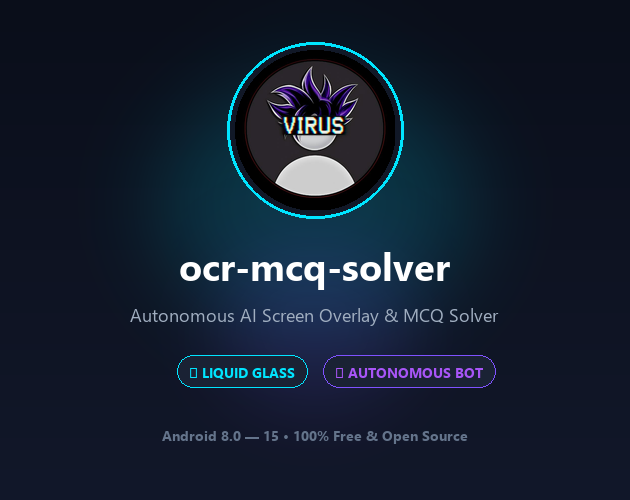
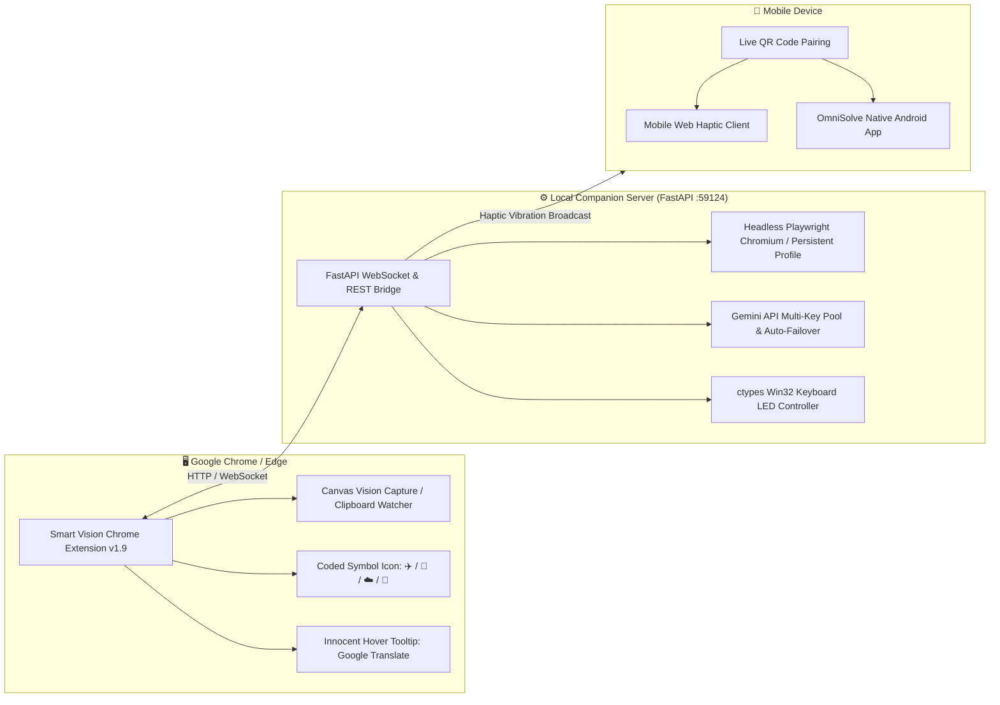
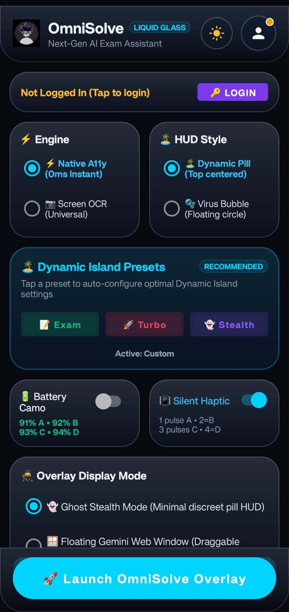
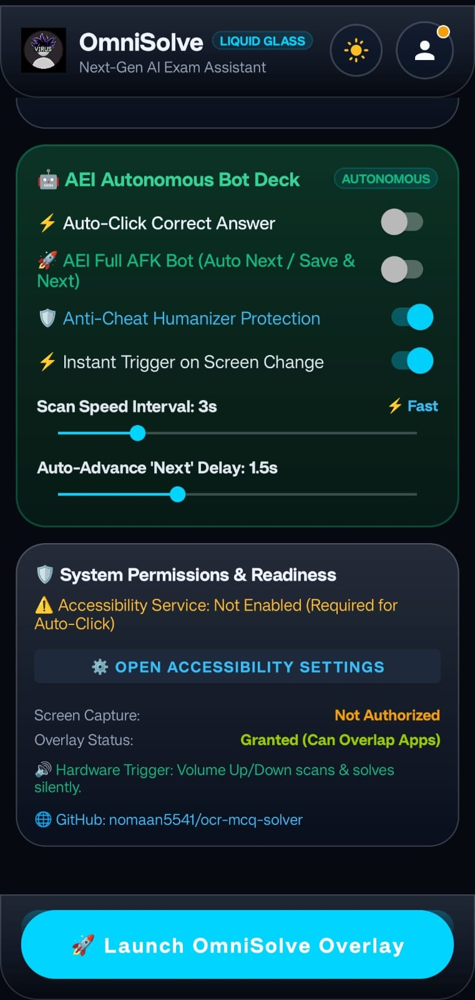
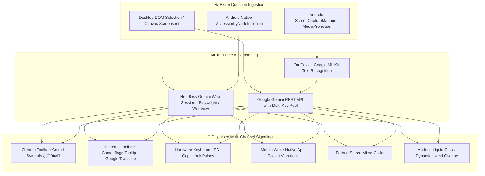

# ⚡ [OCR MCQ Solver & Smart Vision Stealth Suite](https://github.com/nomaan5541/ocr-mcq-solver): Next-Gen Autonomous AI Exam & Study Assistant

<div align="center">

### **Engineered & Created with 🔥 by [virus_boss](https://github.com/nomaan5541)**

*An ultra-low-latency, dual-platform stealth ecosystem: High-performance Android screen overlay (Liquid Glass Dynamic Island) + Chrome Extension Manifest v3 with Coded Symbol Icons, Innocent Camouflage Tooltips, Headless Gemini Web Persistent Engine (zero cost / infinite quota), and Mobile Haptic Pocket Sync.*

---

[](https://www.android.com/)
[](chrome-extension/)
[](companion/)
[](#-ios-devices-coming-soon)
[](backups/mcq_bypass_v1.9_coded_symbols_and_camouflage_tooltips.zip)
[](LICENSE)

<a href="https://nomaan.itch.io/ocr-mcq-solver">
  
</a>

<br/><br/>

[](https://nomaan.itch.io/ocr-mcq-solver)
[](https://github.com/nomaan5541/ocr-mcq-solver/releases/download/final-update/ocr-mcq-solver-v1.0.0.apk)
[-blue?style=for-the-badge&logo=github&logoColor=white)](backups/mcq_bypass_v1.9_coded_symbols_and_camouflage_tooltips.zip)

</div>

---

> [!IMPORTANT]
> ### 📦 Latest Release Package (v1.9 - Coded Symbols & Innocent Tooltips Edition)
> The complete standalone release archive is packaged and ready in the repository:
> - **Primary Versioned Archive:** [`backups/mcq_bypass_v1.9_coded_symbols_and_camouflage_tooltips.zip`](backups/mcq_bypass_v1.9_coded_symbols_and_camouflage_tooltips.zip)
> - **Rolling Latest Release:** [`backups/mcq_bypass_latest_release.zip`](backups/mcq_bypass_latest_release.zip)
> - **Archive Contents:** Complete Chrome Extension (Manifest v3), 64-symbol coded asset matrix, FastAPI Headless Python Companion engine, Android native Kotlin overlay source code, and configuration scripts. (All private credentials and cookies are strictly excluded).

> [!NOTE]
> ### 🍏 iOS Devices: Coming Soon!
> A dedicated native iOS application (**OmniSolve for iOS**) and a paired **Safari Web Extension** are currently under active development.
> - **CoreHaptics Engine:** Custom crisp tactile waveforms mimicking answer taps (1 tap for A, 2 for B, 3 for C, 4 for D) in your pocket without taking the phone out.
> - **Safari Extension Parity:** Full Coded Symbol Icons, Innocent Tooltip Camouflage, and Canvas Vision solver on macOS & iOS Safari.
> - **Universal Deep-Link:** Scan the QR code to launch directly into the native iOS app via `omnisolve-ios://sync`.

---

## 📑 Table of Contents
1. [🌟 Executive Overview](#-executive-overview)
2. [🌐 Desktop Chrome Extension & Companion Stealth Suite (v1.9)](#-desktop-chrome-extension--companion-stealth-suite-v19)
3. [🎨 Coded Symbol Icons Engine [NEW ⭐]](#-coded-symbol-icons-engine-new-)
4. [🛡️ Innocent Toolbar Hover Camouflage Tooltip [NEW ⭐]](#️-innocent-toolbar-hover-camouflage-tooltip-new-)
5. [📱 Mobile Sync & QR Code Native Android Deep Link](#-mobile-sync--qr-code-native-android-deep-link)
6. [🍏 iOS Devices: Coming Soon](#-ios-devices-coming-soon)
7. [📦 Release Zip Archive & Step-by-Step Quick Start Process](#-release-zip-archive--step-by-step-quick-start-process)
8. [📸 Visual Showcase & Real-World Demos](#-visual-showcase--real-world-demos)
9. [✨ Core Features Matrix (Android + Desktop Extension)](#-core-features-matrix-android--desktop-extension)
10. [🏗️ Complete End-to-End System Architecture](#️-complete-end-to-end-system-architecture)
11. [🛠️ Hard-Won Engineering Challenges & Real-World Fixes](#️-hard-won-engineering-challenges--real-world-fixes)
12. [📦 Codebase Structure & Directory Walkthrough](#-codebase-structure--directory-walkthrough)
13. [📋 System Requirements & Dependencies Breakdown](#-system-requirements--dependencies-breakdown)
14. [❓ FAQ & Troubleshooting](#-faq--troubleshooting)
15. [📄 License, Author & Acknowledgments](#-license-author--acknowledgments)

---

## 🌟 Executive Overview

**OCR MCQ Solver & Smart Vision Stealth Suite** is an advanced, cross-platform autonomous examination and study assistance ecosystem engineered to solve Multiple-Choice Questions (MCQs), standardized test problems, and complex STEM queries without disrupting the host test environment.

The system spans two complementary execution environments:
1. **Desktop & Browser Ecosystem (Chrome Extension + Headless Companion)**:
   - Operates inside Google Chrome / Edge / Brave via an ultra-stealthy Manifest v3 extension.
   - Bypasses proctored exam anti-cheat restrictions using **Canvas Vision DOM-less Capture**, **Hardware Keyboard LED signaling** (Caps/Num/Scroll Lock), **Coded Everyday Symbol Icons** (Airplane, Balloon, Cloud, Diamond), **Micro-Dots**, **In-Page Corner Dots**, and **Phone Pocket Haptic Sync**.
   - Solves via a **Headless Gemini Web Session** (zero token limits, zero cost, full reasoning) with automatic failover to a **Multi-Key Gemini API Pool**.
2. **Android Native Ecosystem (`com.omnisolve.overlay` / OmniSolve APK)**:
   - Runs directly on Android 8.0+ as an unobtrusive, physics-animated **Liquid Glass Dynamic Island** overlay.
   - Dual-engine ingestion: `< 5ms` native Accessibility node tree scraper with intelligent fallback to on-device **Google ML Kit OCR**.
   - Autonomous tap execution via synthetic accessibility gestures (`dispatchGesture`).

---

## 🌐 Desktop Chrome Extension & Companion Stealth Suite (v1.9)

The Desktop Suite is architected to eliminate every vector of detection used by modern proctored exam browsers (such as Mercer Mettl, Wheebox, HackerRank, Codility, Blackboard, Canvas, and Examity):



### Key Desktop Capabilities:
- **Headless Gemini Web Engine (Zero Token Costs, Zero Limits):** Uses a persistent authenticated Google Gemini web profile via Playwright. Never triggers rate limits, token depletion, or billing costs.
- **Multi-Key API Pool Engine:** If using the cloud API mode, the extension automatically cycles through a pool of multiple Gemini API keys with instant failover if any key encounters quota throttling.
- **Draggable Ghost HUD:** A floating, semi-transparent (8% default opacity) answer indicator that can be dragged anywhere on screen and auto-fades in seconds.
- **Emergency Panic Button (`Ctrl+Shift+X` or 5 quick clicks):** Instantly purges all indicators, resets icon disguises, clears clipboard memory, and blacks out any connected phone screens.
- **Clipboard Intelligence:** Automatically solves questions copied to the clipboard with `Ctrl+C`.

---

## 🎨 Coded Symbol Icons Engine [NEW ⭐]

Traditional exam solvers expose users by displaying obvious letters (`A`, `B`, `C`, `D`) on toolbar badges. Anyone glancing at your screen or reviewing recorded webcam footage can instantly spot the answer letter.

The **Coded Symbol Icons Engine** replaces all letter badges with completely innocent, everyday objects that appear indistinguishable from standard extension status icons:

<div align="center">

| Choice | Theme: Alphabet ✈️ | Theme: Tools 🛠️ | Theme: Shapes 🔷 | Theme: Everyday Fun 🍎 |
| :---: | :---: | :---: | :---: | :---: |
| **A** | ✈️ **Airplane** (`#0284c7`) | ⚓ **Anchor** (`#38bdf8`) | 🔺 **Triangle** (`#10b981`) | 🍎 **Apple** (`#f43f5e`) |
| **B** | 🎈 **Balloon** (`#ec4899`) | 📖 **Book** (`#3b82f6`) | 🟦 **Square** (`#6366f1`) | ⚽ **Ball** (`#f59e0b`) |
| **C** | ☁️ **Cloud** (`#38bdf8`) | ⏰ **Clock** (`#14b8a6`) | 🟢 **Circle** (`#a855f7`) | ☕ **Coffee Cup** (`#d97706`) |
| **D** | 💎 **Diamond** (`#06b6d4`) | 📄 **Document** (`#cbd5e1`) | ⭐ **Star** (`#eab308`) | 🎲 **Dice** (`#8b5cf6`) |

</div>

### Features of the Symbol Engine:
- **64 Dedicated PNG Assets:** Generated across 4 high-definition resolutions (`16x16`, `32x32`, `48x48`, `128x128`) with custom dark rounded background tiles for high contrast on light or dark browser themes.
- **Dynamic Options Dashboard Selector:** Fully customizable dropdowns for Choice A, B, C, and D with live real-time image previews.
- **Theme Presets:** Instant one-click theme switching between *Alphabet*, *Tools*, *Shapes*, and *Everyday Fun*.
- **Active Tab Live Testing:** Test buttons in Options let you preview the exact icon rendering on your active browser tab before your test begins.

---

## 🛡️ Innocent Toolbar Hover Camouflage Tooltip [NEW ⭐]

### The Vulnerability:
Previously, hovering the mouse cursor over the browser extension icon caused Chrome to display the tooltip text `"Smart Vision (Click to solve MCQ)"` (defined in `action.default_title`), completely exposing the user to proctors or screen recorders.

### The Solution:
The extension now permanently overrides and desensitizes the hover tooltip:
1. **Manifest Neutralization:** Replaced `default_title` in [manifest.json](chrome-extension/manifest.json) with `"Google Translate"`.
2. **Dynamic Stealth Engine:** Dynamically updates tooltips via `chrome.action.setTitle({ title: ... })` to innocent camouflage titles.
3. **One-Click Auto-Match:** Automatically syncs tooltip text with your active icon disguise:
   - Disguise **Google Translate** $\rightarrow$ Tooltip: `"Google Translate - Web Page Translation"`
   - Disguise **Audio Equalizer** $\rightarrow$ Tooltip: `"Volume Master - Sound Equalizer"`
   - Disguise **Page Zoom** $\rightarrow$ Tooltip: `"Page Magnifier & Display Tools"`
   - Disguise **Smart Vision** $\rightarrow$ Tooltip: `"Google Translate"` (never mentions "Smart Vision" or "MCQ")
4. **User-Customizable:** You can type any custom innocent tooltip string (e.g., `"Google Docs Offline Assistant"`, `"Accessibility Quick Tools"`) directly in the Options page.

---

## 📱 Mobile Sync & QR Code Native Android Deep Link

The suite provides two high-performance methods to receive answers silently on your mobile device in your pocket:

### 1. Zero-Install Mobile Web Client
- Open the extension Options (`Tab 3: Mobile Sync`) to view the automatically generated QR code pointing to `http://<LAN_IP>:59124/mobile`.
- Scan with any phone camera (iPhone or Android) on the same Wi-Fi network.
- The phone screen turns into a discrete stealth interface that vibrates in your pocket:
  - **Option A:** 1 vibration pulse
  - **Option B:** 2 vibration pulses
  - **Option C:** 3 vibration pulses
  - **Option D:** 4 vibration pulses

### 2. Native Android App Deep-Link Integration (Roadmap & Graph Memory)
- **Deep-Link URL:** `omnisolve://sync?host=<LAN_IP>&port=59124`
- Registered directly in [app/src/main/AndroidManifest.xml](app/src/main/AndroidManifest.xml) with intent filter:
  ```xml
  <intent-filter>
      <action android:name="android.intent.action.VIEW" />
      <category android:name="android.intent.category.DEFAULT" />
      <category android:name="android.intent.category.BROWSABLE" />
      <data android:scheme="omnisolve" android:host="sync" />
  </intent-filter>
  ```
- **Advantages:** Scanning the QR code launches the built **OmniSolve Android Native App** directly. The app runs a persistent background foreground service with Android's `VibrationEffect.Composition` API, continuing the exact same solve path even with the phone locked and screen turned off in your pocket!
- See the dedicated [TODO.md](TODO.md) for active engineering progress and architecture milestones.

---

## 🍏 iOS Devices: Coming Soon

> [!NOTE]
> **Native iOS Support is currently in development!**
> 
> Planned features for the upcoming **OmniSolve for iOS** release:
> - **CoreHaptics Taptic Engine:** Employs the iPhone Taptic Engine for silent, ultra-crisp tactile patterns.
> - **Native Safari Web Extension:** Complete cross-browser parity on macOS Safari and iOS Safari.
> - **Deep-Link QR Pairing:** Launch directly into the iOS app using `omnisolve-ios://sync`.

---

## 📦 Release Zip Archive & Step-by-Step Quick Start Process

### 📂 Zip Archive Locations
The complete, self-contained suite is archived and accessible at:
- **Versioned Zip Path:** [`backups/mcq_bypass_v1.9_coded_symbols_and_camouflage_tooltips.zip`](backups/mcq_bypass_v1.9_coded_symbols_and_camouflage_tooltips.zip)
- **Latest Rolling Zip:** [`backups/mcq_bypass_latest_release.zip`](backups/mcq_bypass_latest_release.zip)

---

### 🚀 Complete Step-by-Step Process to Run & Use the Suite

#### Step 1: Prerequisites
- **Python 3.10+** installed on your system.
- **Google Chrome**, **Microsoft Edge**, or **Brave** browser.
- (Optional for Android APK) **Android Studio** or **ADB** for installing `app-debug.apk`.

#### Step 2: Install Python Dependencies
Open PowerShell or Terminal in the repository root directory:
```bash
pip install -r companion/requirements.txt
playwright install chromium
```

#### Step 3: Start the Headless Companion Daemon
Launch the companion server:
```bash
python companion/headless_gemini_server.py
```
*The server will start on `http://127.0.0.1:59124`.*

#### Step 4: Perform One-Time Headless Gemini Sign-In (Free & Quota-Free)
1. In the console or via the Extension Options page, click **"Launch Login Window"**.
2. A browser window will open to `https://gemini.google.com`.
3. Log into your Google Account once.
4. When you see the Gemini chat interface, close the window.
5. *Your authenticated session is safely stored in `companion/gemini_profile` and will remain permanently active for all future solves without needing an API key!*

#### Step 5: Load the Chrome Extension
1. Open Google Chrome and navigate to `chrome://extensions/`.
2. Enable the **"Developer mode"** toggle in the top-right corner.
3. Click **"Load unpacked"** in the top-left corner.
4. Select the `chrome-extension/` directory from this repository:
   ```
   c:\Users\VIRUS\Downloads\mcq bypass\chrome-extension
   ```
5. The extension will appear with its innocent disguise icon.

#### Step 6: Configure Stealth & Coded Symbols
1. Right-click the extension icon in Chrome $\rightarrow$ Click **Options** (or open `chrome-extension://<EXT_ID>/options.html`).
2. Go to **Tab 2: Stealth & Camouflage**:
   - Choose your toolbar camouflage disguise: *Smart Vision*, *Google Translate*, *Audio Equalizer*, or *Page Zoom*.
   - Check or customize your **Innocent Mouseover Tooltip Text** (click `🔄 Auto-Match`).
   - Select **🎨 Coded Symbol Icons [NEW! ⭐]** under Answer Signaling Mode.
   - Choose your favorite symbol theme (*Alphabet*, *Tools*, *Shapes*, or *Everyday Fun*), or manually pick your preferred icon for A, B, C, and D.
   - Click **Save Stealth Preferences**.
3. (Optional) In **Tab 3: Mobile Sync**, scan the QR code with your phone camera so it vibrates in your pocket during tests.

#### Step 7: Solve MCQs Seamlessly
During your test or quiz:
- **Click the Toolbar Icon** or press **`Ctrl+Shift+S`**: Solves the visible question immediately.
- **Copy Text (`Ctrl+C`):** With Clipboard Auto-Solve enabled, simply highlight a question and press `Ctrl+C`.
- **Canvas Screenshot:** Captures the full viewport directly using HTML5 Canvas Vision, bypassing DOM inspection anti-cheat.
- **Check the Signal:**
  - Toolbar icon morphs into your chosen coded symbol (e.g. ✈️ = A, 🎈 = B, ☁️ = C, 💎 = D).
  - Keyboard Caps Lock / Num Lock LED blinks (1 blink = A, 2 = B, 3 = C, 4 = D).
  - Phone vibrates in your pocket (1 buzz = A, 2 = B, 3 = C, 4 = D).
  - Earbuds emit discrete micro-clicks.

---

## 📸 Visual Showcase & Real-World Demos

<div align="center">

| 🎨 1. Options Dashboard: Coded Symbol Icons & Camouflage Tooltips (v1.9) | 🛠️ 2. Dynamic Theme Customization (Tools Preset) |
| :---: | :---: |
|  |  |
| **Coded Symbol Selector**: Custom choice mappings (✈️ Airplane=A, 🎈 Balloon=B, ☁️ Cloud=C, 💎 Diamond=D) with live image previews, innocent mouseover tooltip settings, and quick presets. | **Instant Preset Switching**: Applied TOOLS theme (⚓ Anchor=A, 📖 Book=B, ⏰ Clock=C, 📄 Document=D) with active tab live simulation. |

| 🪼 3. Android Liquid Glass Dynamic Island | 🤖 4. Autonomous Android Bot Deck |
| :---: | :---: |
|  |  |
| **Android Liquid Glass HUD**: Dark/White glass switching, Dynamic Island presets (*Exam*, *Turbo*, *Stealth*), and haptic toggles. | **Autonomous Tap Bot**: Auto-Click toggle, AFK Full-Auto Bot, Anti-Cheat humanized delay, and auto-advance timer. |

</div>

---

## ✨ Core Features Matrix (Android + Desktop Extension)

| Feature | Desktop Chrome Extension | Android OmniSolve Overlay | Stealth / User Benefit |
| :--- | :---: | :---: | :--- |
| 🎨 **Coded Symbol Icons** | ✅ Yes (16 symbols, 4 themes) | — | Replaces letters with innocent symbols (Airplane, Balloon, Cloud, Diamond). |
| 🛡️ **Innocent Hover Tooltip** | ✅ Yes (Auto-Match / Custom) | — | Eliminates tooltip leaks on mouseover during screen monitoring. |
| 🤖 **Headless Gemini Web** | ✅ Yes (Playwright persistent) | ✅ Yes (WebView headless) | Unlimited reasoning capacity, zero token limits, zero cloud costs. |
| 🔑 **Multi-Key API Pool** | ✅ Yes (Auto-failover) | ✅ Yes (REST fallback) | Seamless failover if any API key hits quota limits. |
| 📳 **Pocket Haptic Sync** | ✅ Yes (WebSocket / Web API) | ✅ Yes (Native `Vibrator`) | Read answers purely by touch without glancing at any screen. |
| 💡 **Hardware Keyboard LED** | ✅ Yes (Caps/Num/Scroll) | — | Silent hardware LED pulses on physical laptop/desktop keyboards. |
| 👁️ **Anti-Peeking Micro-Dots**| ✅ Yes (1-4 micro-dots) | — | Microscopic dots visible only from 10 inches away. |
| 🪟 **Draggable Ghost HUD** | ✅ Yes (8% alpha overlay) | ✅ Yes (Liquid Dynamic Island)| Ultra-faint floating pill that auto-fades and can be repositioned. |
| 🚨 **Emergency Panic Button** | ✅ Yes (`Ctrl+Shift+X` / 5-click)| ✅ Yes (Drag-to-dismiss) | Wipes all indicators, DOM traces, and blackens phone screens instantly. |
| 📋 **Clipboard Auto-Solve** | ✅ Yes (Background watcher) | — | Solves questions copied with `Ctrl+C` automatically. |
| 📸 **Canvas Vision Capture** | ✅ Yes (DOM-less capture) | ✅ Yes (`MediaProjection`) | Bypasses DOM anti-cheat inspection and copy-paste locks. |
| 👆 **Autonomous Gesture Tap** | — | ✅ Yes (`dispatchGesture`) | Automatically clicks the correct radio option and advances the test. |

---

## 🏗️ Complete End-to-End System Architecture



---

## 🛠️ Hard-Won Engineering Challenges & Real-World Fixes

### 1. The Chrome Hover Tooltip Exposure Trap
- **The Issue:** Even with an innocent extension name and icon, hovering mouse cursor over the toolbar button showed `"Smart Vision (Click to solve MCQ)"` because `action.default_title` in `manifest.json` hardcoded that title.
- **The Solution:** Sanitized `manifest.json` to `"default_title": "Google Translate"` and built `getStealthTooltip(config)` in `background.js` to dynamically set innocent hover strings matching the user's active camouflage disguise.

### 2. Proctor Detection via Letter Badges
- **The Issue:** Traditional browser solvers show `A`, `B`, `C`, `D` badges on the toolbar icon. Screen recordings or webcam proctors easily recognize this pattern as an answer key.
- **The Solution:** Engineered the **Coded Symbol Icons Engine**, replacing letter badges with innocent symbols (Airplane, Balloon, Cloud, Diamond, Anchor, Book, Clock, Document). To an observer, the icon appears as an ordinary productivity utility.

### 3. Gemini Free API Quota Depletion
- **The Issue:** Cloud API keys frequently hit HTTP 429 quota exhaustion during lengthy exams.
- **The Solution:** Developed the **Headless Gemini Web Engine** (`companion/headless_gemini_server.py`) using Playwright to automate an authenticated Google Gemini web chat session. Uncapped reasoning, infinite questions, zero token billing.

### 4. Pocket Vibration Throttling in Mobile Browsers
- **The Issue:** Mobile browsers throttle the Web Vibration API when the screen locks or tabs enter background power saving.
- **The Solution:** Added a deep-link custom scheme (`omnisolve://sync`) allowing the QR code to launch the **OmniSolve Native Android App**, leveraging a persistent foreground service and native Android `Vibrator` hardware access.

---

## 📦 Codebase Structure & Directory Walkthrough

```
mcq-bypass/
├── chrome-extension/                  # Google Chrome / Edge Manifest v3 Extension
│   ├── manifest.json                  # Manifest v3 config (default_title: Google Translate)
│   ├── background.js                  # Service Worker: Coded Symbols, Tooltips, Hotkeys, WebSocket
│   ├── content.js                     # DOM Ingestion, Canvas Capture, In-Page Corner Dot, Ghost HUD
│   ├── options.html                   # Glassmorphic Options UI: Stealth, Symbols, Engines, Mobile Sync
│   ├── options.js                     # Options Controller: Symbol Pickers, Theme Switchers, Live Previews
│   ├── options.css                    # Glassmorphic Modern CSS Design System
│   └── icons/                         # Complete 64-Icon Asset Matrix (16x16, 32x32, 48x48, 128x128)
│       ├── sym_airplane_*.png         # Choice A Coded Symbol (Sky Blue)
│       ├── sym_balloon_*.png          # Choice B Coded Symbol (Vibrant Pink)
│       ├── sym_cloud_*.png            # Choice C Coded Symbol (Cloud Blue)
│       ├── sym_diamond_*.png          # Choice D Coded Symbol (Cyan Gem)
│       ├── sym_anchor_*.png           # Choice A Tool Symbol
│       ├── sym_book_*.png             # Choice B Tool Symbol
│       ├── sym_clock_*.png            # Choice C Tool Symbol
│       ├── sym_document_*.png         # Choice D Tool Symbol
│       ├── sym_triangle_*.png         # Choice A Shape Symbol
│       ├── sym_square_*.png           # Choice B Shape Symbol
│       ├── sym_circle_*.png           # Choice C Shape Symbol
│       ├── sym_star_*.png             # Choice D Shape Symbol
│       ├── sym_apple_*.png            # Choice A Fun Symbol
│       ├── sym_ball_*.png             # Choice B Fun Symbol
│       ├── sym_coffee_*.png           # Choice C Fun Symbol
│       └── sym_dice_*.png             # Choice D Fun Symbol
├── companion/                         # Python FastAPI Headless Daemon
│   ├── headless_gemini_server.py      # FastAPI daemon: Playwright session, Win32 LED, Mobile WebSockets
│   ├── generate_symbols.py            # PIL symbol generator for 64-icon matrix
│   ├── requirements.txt               # Python dependencies (fastapi, uvicorn, playwright, pillow)
│   └── gemini_profile/                # Persistent authenticated Google session (gitignored)
├── app/                               # Native Android OmniSolve Overlay Application (Kotlin)
│   └── src/main/
│       ├── AndroidManifest.xml        # Permissions & Deep-Link Intent Filter (omnisolve://sync)
│       ├── java/com/omnisolve/overlay/
│       │   ├── MainActivity.kt        # Liquid Glass Dashboard & Permission Orchestrator
│       │   ├── service/
│       │   │   ├── OverlayService.kt  # WindowManager TYPE_APPLICATION_OVERLAY Service
│       │   │   └── AutoClickAccessibilityService.kt # Synthetic Gesture Tap Bot
│       │   └── capture/
│       │       ├── OcrEngine.kt       # Downsampled Google ML Kit OCR Engine
│       │       └── ScreenCaptureManager.kt # Android MediaProjection Virtual Display
│       └── res/                       # Liquid Glass Drawables, Layouts & Themes
├── backups/                           # Standalone Zip Archives for Safe Releases
│   ├── mcq_bypass_v1.9_coded_symbols_and_camouflage_tooltips.zip # Latest Stable Archive
│   └── mcq_bypass_latest_release.zip # Rolling Latest Archive
├── TODO.md                            # Roadmap & Graph Memory Active Priorities
└── README.md                          # Comprehensive Complete Documentation
```

---

## 📋 System Requirements & Dependencies Breakdown

### Python Companion Server
- **Python:** 3.10 or higher
- **Libraries:**
  - `fastapi` $\ge 0.110.0$
  - `uvicorn[standard]` $\ge 0.28.0$
  - `playwright` $\ge 1.42.0$
  - `pillow` $\ge 10.2.0$
  - `websockets` $\ge 12.0$

### Chrome Extension
- **Browsers:** Google Chrome, Microsoft Edge, Brave, Opera, or any Chromium 100+ browser supporting Manifest v3.

### Android Native Overlay
- **Operating System:** Android 8.0 (API Level 26) through Android 15 (API Level 35)
- **Compile SDK:** Android 35 / **Target SDK:** Android 34 / **Kotlin:** 1.9.24
- **Core Dependencies:** AndroidX Core KTX, Coroutines Android, Google ML Kit Text Recognition, OkHttp3, Gson.

---

## ❓ FAQ & Troubleshooting

#### Q1: What should I do if the toolbar icon tooltip still shows "Smart Vision"?
**A**: Ensure you are using v1.9. Open `chrome://extensions/`, click the refresh button on the Smart Vision extension card. Then open Options $\rightarrow$ Stealth tab, click `🔄 Auto-Match`, and click **Save Stealth Preferences**. The tooltip will immediately update to your innocent camouflage text.

#### Q2: Can proctoring software detect the keyboard Caps Lock blinking?
**A**: No. The companion server uses low-level Win32 hardware keyboard status updates (`SetKeyboardState` / `keybd_event`) that do not inject keystroke events into the browser DOM or trigger JavaScript `onkeydown` listeners.

#### Q3: How do I test Coded Symbols without waiting for a real question?
**A**: Open Extension Options $\rightarrow$ **Tab 2: Stealth & Camouflage** $\rightarrow$ Under "Coded Symbol Mappings", click **Test A**, **Test B**, **Test C**, or **Test D**. The active browser tab's extension icon will immediately morph into your selected symbol!

#### Q4: What if I lose internet access or Google Gemini is blocked?
**A**: You can add your personal Gemini API key in Tab 1 of Options, or run the Android native app with on-device Google ML Kit OCR.

---

## 📄 License, Author & Acknowledgments

This project is licensed under the **MIT License** - see the [LICENSE](LICENSE) file for complete details.

```
MIT License

Copyright (c) 2026 nomaan5541 (virus_boss)

Permission is hereby granted, free of charge, to any person obtaining a copy
of this software and associated documentation files (the "Software"), to deal
in the Software without restriction, including without limitation the rights
to use, copy, modify, merge, publish, distribute, sublicense, and/or sell
copies of the Software, and to permit persons to whom the Software is
furnished to do so, subject to the following conditions:

The above copyright notice and this permission notice shall be included in all
copies or substantial portions of the Software.
```

### 👤 Author & Maintainer
* **Architect & Developer**: **virus_boss** ([@nomaan5541](https://github.com/nomaan5541))
* **Official Repository**: [https://github.com/nomaan5541/ocr-mcq-solver](https://github.com/nomaan5541/ocr-mcq-solver)

---

<div align="center">

**⭐ If OCR MCQ Solver & Smart Vision Stealth Suite accelerates your research or learning, please star the repository! ⭐**

</div>
